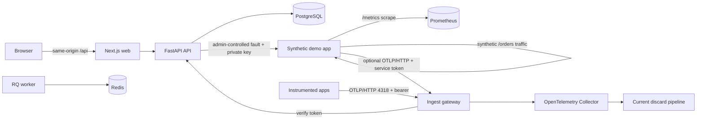

# Architecture

OpsDetective is a monorepo with one browser application, one API, a background worker, a synthetic demo application, an authenticated ingest gateway, and local data services.

## Trust boundaries

The browser is untrusted. The API validates request bodies, checks administrator sessions and CSRF tokens, and applies tenant filters to every entity query. The browser connects to the API through a same-origin web rewrite; PostgreSQL, Redis, Prometheus, and the API are not published to the host. Only the web port and the ingest gateway (OTLP/HTTP 4318) are published. The gateway verifies each bearer token against the API's hashed records over the private network (internal key), then forwards to the Collector with server-stamped identity headers. The Collector is unpublished and currently discards received data until the M1 storage pipeline lands.

The administrator password is hashed with Argon2id in PostgreSQL. Session tokens and CSRF tokens are hashed with a keyed digest before storage. The Compose `.env` file is excluded from Git and Docker build contexts. A separate production deployment must use HTTPS, secure cookies, protected network ingress, and a secret manager.

## Synthetic demo controls

The demo service generates fixed `/orders` requests at a configurable interval. It emits bounded route/status Prometheus metrics, OpenTelemetry metrics and traces when `DEMO_INGEST_TOKEN` is set, and JSON request logs with a trace ID. The token must belong to a registered service; the demo sends it only to the gateway, not directly to the Collector. The current Collector pipeline discards OTLP payloads after acceptance.

Faults are disabled by default. When enabled, an administrator uses `POST /api/v1/demo/faults` with a valid session and CSRF token. The API limits each administrator to three changes per minute, audits successful changes, and calls the demo service over the private network with a separate control key. Modes are `http_500`, `slow_db` (a synthetic 750 ms database wait), and `off`. Fault windows are limited to 5–120 seconds and automatically expire; `/healthz` remains independent of an order fault.

| Environment variable | Purpose |
| --- | --- |
| `DEMO_FAULTS_ENABLED` | Enables the fault control route; default `false` |
| `DEMO_CONTROL_KEY` | Shared API-to-demo control secret; required by Compose |
| `DEMO_TRAFFIC_ENABLED` | Runs synthetic `/orders` traffic; default `true` |
| `DEMO_TRAFFIC_INTERVAL_SECONDS` | Seconds between generated requests, from 0.5 to 60; default `2` |
| `DEMO_INGEST_TOKEN` | Optional service ingestion token for OTLP/HTTP metric and trace export |
| `DEMO_GATEWAY_URL` | Private gateway base URL supplied by Compose to the demo service |

## Service inventory

| Service | Role | Persistent state |
| --- | --- | --- |
| web | Next.js interface and API reverse proxy | None |
| api | Authentication, projects, services, audit events | PostgreSQL |
| worker | RQ queue consumer for future investigations | Redis job state |
| demo-app | Synthetic `/orders` traffic, faults, JSON logs, `/healthz`, and `/metrics` | None |
| gateway | Bearer-token check and forwarding for OTLP/HTTP | None (15 s token cache) |
| collector | OTLP receiver, M0 discard pipeline | None |
| prometheus | Scrapes demo metrics every 15 seconds | Named volume, 15-day time retention |
| postgres | Application records | Named volume |
| redis | Short-lived queue data | Named volume |

## Data contract and versioning

Application records use UUID string IDs and tenant IDs from the first migration. `Project` owns `Service`; the API checks both the project ID and tenant ID before service creation. API routes are versioned under `/api/v1`. Schema changes require Alembic migrations and tests. Canonical logs, metric points, trace spans, baselines, incidents, and investigations are specified in the internal PRD and will be added by milestone.
