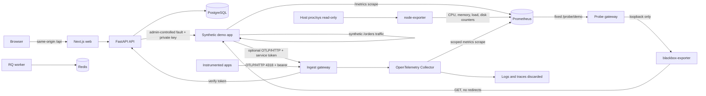

# Architecture

OpsDetective is a monorepo with one browser application, one API, a background worker, a synthetic demo application, an authenticated ingest gateway, and local data services.

## Trust boundaries

The browser is untrusted. The API validates request bodies, checks administrator sessions and CSRF tokens, and applies tenant filters to every entity query. The browser connects to the API through a same-origin web rewrite; PostgreSQL, Redis, Prometheus, and the API are not published to the host. Only the web port and the ingest gateway (OTLP/HTTP 4318) are published. The gateway verifies each bearer token against the API's hashed records over the private network (internal key), then forwards to the Collector with server-stamped identity headers. The Collector is unpublished. It copies the authenticated request identity into metric labels before batching and exposes metrics only to private Prometheus. Logs and traces are accepted and discarded.

The administrator password is hashed with Argon2id in PostgreSQL. Session tokens and CSRF tokens are hashed with a keyed digest before storage. The Compose `.env` file is excluded from Git and Docker build contexts. A separate production deployment must use HTTPS, secure cookies, protected network ingress, and a secret manager.

## Synthetic demo controls

The demo service generates fixed `/orders` requests at a configurable interval. It emits bounded route/status Prometheus metrics, OpenTelemetry metrics and traces when `DEMO_INGEST_TOKEN` is set, and JSON request logs with a trace ID. The token must belong to a registered service; the demo sends it only to the gateway, not directly to the Collector. OTLP metrics are retained in Prometheus with authenticated tenant, project and service labels; traces are currently discarded after acceptance.

Faults are disabled by default. When enabled, an administrator uses `POST /api/v1/demo/faults` with a valid session and CSRF token. The API limits each administrator to three changes per minute, audits successful changes, and calls the demo service over the private network with a separate control key. Modes are `http_500`, `slow_db` (a synthetic 750 ms database wait), and `off`. Fault windows are limited to 5–120 seconds and automatically expire; `/healthz` remains independent of an order fault.

| Environment variable | Purpose |
| --- | --- |
| `DEMO_FAULTS_ENABLED` | Enables the fault control route; default `false` |
| `DEMO_CONTROL_KEY` | Shared API-to-demo control secret; required by Compose |
| `DEMO_TRAFFIC_ENABLED` | Runs synthetic `/orders` traffic; default `true` |
| `DEMO_TRAFFIC_INTERVAL_SECONDS` | Seconds between generated requests, from 0.5 to 60; default `2` |
| `DEMO_INGEST_TOKEN` | Optional service ingestion token for OTLP/HTTP metric and trace export |
| `DEMO_GATEWAY_URL` | Private gateway base URL supplied by Compose to the demo service |

## Service inventory

| Service | Role | Persistent state |
| --- | --- | --- |
| web | Next.js interface and API reverse proxy | None |
| api | Authentication, projects, services, audit events | PostgreSQL |
| worker | RQ queue consumer for future investigations | Redis job state |
| demo-app | Synthetic `/orders` traffic, faults, JSON logs, `/healthz`, and `/metrics` | None |
| gateway | Bearer-token check and forwarding for OTLP/HTTP | None (15 s token cache) |
| collector | OTLP/HTTP receiver, identity processors and private Prometheus exporter; logs/traces discarded | In-memory metric cache, 60 s expiry |
| node-exporter | Host CPU, memory, load and disk counters via read-only `/proc` and `/sys` | None |
| probe-gateway | Fixed allowlist route to the loopback-only blackbox listener | None |
| blackbox-exporter | Five-second HTTP probe of demo `/healthz`, redirects disabled | None |
| prometheus | Scrapes demo, authenticated OTLP, host and availability metrics every 15 seconds | Named volume, 15-day time retention |
| postgres | Application records | Named volume |
| redis | Short-lived queue data | Named volume |

## Data contract and versioning

Application records use UUID string IDs and tenant IDs from the first migration. `Project` owns `Service`; the API checks both the project ID and tenant ID before service creation. API routes are versioned under `/api/v1`. Schema changes require Alembic migrations and tests. Canonical logs, metric points, trace spans, baselines, incidents, and investigations are specified in the internal PRD and will be added by milestone.

## Host metrics and restricted probes

The Linux core stack mounts host `/proc` and `/sys` read-only into node-exporter. Only CPU, memory, load and disk-counter collectors are enabled. Filesystem capacity and host network-interface metrics are intentionally not collected: the container has neither a host root mount nor host network access. No Docker socket, privileged mode, host PID namespace or new environment variable is required. These infrastructure metrics stay in the private Prometheus instance; they are not tenant-owned application records or exposed to browser users.

Prometheus scrapes `node-exporter:9100` and `probe-gateway:9116/probe/demo` every 15 seconds. The probe gateway accepts only GET with no query string on that fixed route, and constructs a constant blackbox request for `http://demo-app:8001/healthz`. It forwards no caller headers or body. All other paths are denied except its own `/healthz`. Blackbox listens on loopback port 9115 in the gateway's network namespace, so other containers cannot bypass the allowlist. Probe timeout is five seconds; redirects are disabled, IPv4 is required, and only HTTP 200 succeeds. This checks process health; synthetic order faults do not make `/healthz` fail.

No arbitrary URL registration is implemented. Adding a destination requires a reviewed fixed gateway route and matching Prometheus scrape configuration, including explicit approval for any private service target. Do not expose the raw blackbox port or replace the constant upstream URL with request arguments. Exporter ports are unpublished. Prometheus retains the samples for 15 days. Run `scripts/compose-exporters.py` inside the API test container to verify metric ingestion, successful probing and denial of alternate targets.

## Authenticated metric storage

The OTLP/HTTP receiver includes request metadata. Before batching, the resource processor deletes client identity and inserts the gateway's `x-opd-tenant-id`, `x-opd-project-id` and `x-opd-service-id` values as `tenant_id`, `project_id` and `service_id`. Metric resources retain only these identities. A datapoint transform removes alternate identity spellings and copies the authenticated values into datapoint labels; points without all three labels are dropped. The gRPC receiver is disabled because this ingestion path authenticates HTTP only. Collector and data-service network access are trusted infrastructure boundaries; never publish their ports.

The Collector exposes metrics on private port 8889 for Prometheus's `otlp` scrape job. Source timestamps are preserved so cached samples cannot look freshly collected. The exporter expires metrics after 60 seconds without an update, and Prometheus retains scraped samples for 15 days. Each scrape is limited to 20,000 samples, 32 labels per sample, 128-character label names and 256-character values; exceeding those limits fails the scrape rather than partially importing it. OTLP requests retain the gateway's 10 MiB body cap. These are operating bounds, not measured capacity claims. Authenticated producers must use bounded metric labels; per-tenant ingestion quotas remain future hardening work.

`scripts/compose-metric-isolation.py` sends synthetic metrics under two project tokens and verifies persisted identity despite forged headers, resource attributes and datapoint labels. It also confirms an identity-free direct Collector write is dropped. The registered-demo export check additionally requires its request counter and latency histogram to reach Prometheus with the registered service/project labels. Neither check writes service tokens to files or test output. No public raw-query API is exposed.
