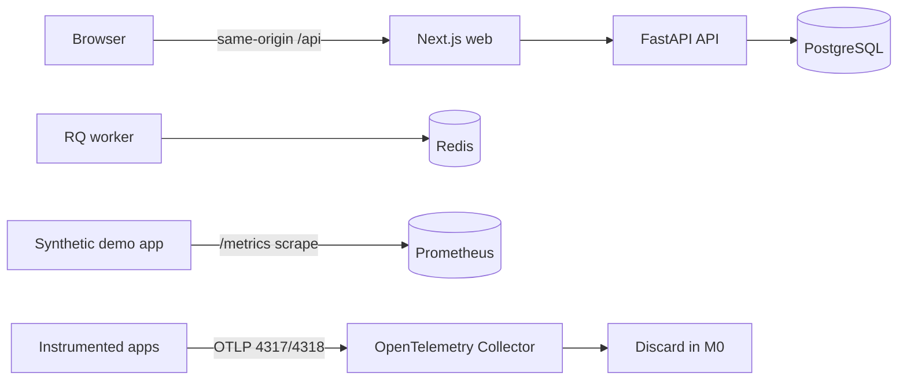

# Foundation architecture

OpsDetective is a monorepo with one browser application, one API, a background worker, a synthetic demo application, and three local data services. The current M0 stack establishes the boundaries; telemetry processing and incident workflows are later milestones.

## Trust boundaries

The browser is untrusted. The API validates request bodies, checks administrator sessions and CSRF tokens, and applies tenant filters to every entity query. The browser connects to the API through a same-origin web rewrite; PostgreSQL, Redis, Prometheus, and the API are not published to the host. Only the web port and Collector ingress are published. Collector ingress currently has no per-service token enforcement and discards received data, so it must remain on a trusted local network until M1 adds authentication and storage.

The administrator password is hashed with Argon2id in PostgreSQL. Session tokens and CSRF tokens are hashed with a keyed digest before storage. The Compose `.env` file is excluded from Git and Docker build contexts. A separate production deployment must use HTTPS, secure cookies, protected network ingress, and a secret manager.

## Service inventory

| Service | Role | Persistent state |
| --- | --- | --- |
| web | Next.js interface and API reverse proxy | None |
| api | Authentication, projects, services, audit events | PostgreSQL |
| worker | RQ queue consumer for future investigations | Redis job state |
| demo-app | Synthetic `/healthz` and `/metrics` endpoint | None |
| collector | OTLP receiver, M0 discard pipeline | None |
| prometheus | Scrapes demo metrics every 15 seconds | Named volume, 30-day time retention |
| postgres | Application records | Named volume |
| redis | Short-lived queue data | Named volume |

## Data contract and versioning

Application records use UUID string IDs and tenant IDs from the first migration. `Project` owns `Service`; the API checks both the project ID and tenant ID before service creation. API routes are versioned under `/api/v1`. Schema changes require Alembic migrations and tests. Canonical logs, metric points, trace spans, baselines, incidents, and investigations are specified in the internal PRD and will be added by milestone.
